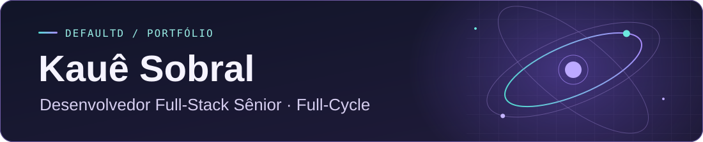

  

Desenvolvedor full-stack sênior com mais de cinco anos de experiência e atuação **full-cycle**. Trabalho da arquitetura e do código à publicação na **AWS**, com foco em escalabilidade.

- Automatizo builds, testes e deploys com **CI/CD** e uso ambientes separados para validar mudanças antes de publicar.
- Uso **Docker** para empacotar serviços e **Kubernetes** para orquestrar a execução e escalar conforme a demanda.
- Uso **filas e mensageria** para executar tarefas demoradas em segundo plano e manter as APIs responsivas.

## Projetos principais

### 🪐 Orion v2

**Plataforma para operações de marketplace · Código privado**

Reúne pesquisa de produtos, catálogo, estoque e campanhas em um só ambiente. A IA auxilia na pesquisa e na criação de rascunhos de mídia, com revisão humana antes de avançar.

`TypeScript` · `Next.js` · `NestJS` · `PostgreSQL` · `Python` · `Docker`

### OrbixHub

**SaaS multi-tenant de gestão operacional**

Cada empresa tem seu próprio ambiente para controlar estoque e despesas, gerenciar a equipe, emitir ordens de serviço e operar o caixa. O **Orbix Admin** integra o suporte à plataforma.

## Repositórios em destaque

| Projeto | O que você encontra | Stack |
| --- | --- | --- |
| [CRUD Vue + Firebase](https://github.com/DefaultD/CrudVue-Firebase) | Protótipo de painel comercial com telas de produtos e pedidos. | Vue · Firebase |
| [Memoteca](https://github.com/DefaultD/memoteca) | Aplicação para criar e organizar um mural de pensamentos. | Angular · TypeScript |
| [TradeZone](https://github.com/DefaultD/TradeZone) | Plataforma de anúncios e trocas de cartas de Magic: The Gathering, com catálogo e perfis. | Next.js · NestJS · PostgreSQL |

## Arquitetura e produto

- **BackEngine** — framework backend em TypeScript e Fastify para compartilhar autenticação, migrações e filas de tarefas entre serviços.
- **SaaS de licitações** — sistema de gestão de processos licitatórios com dados isolados por cliente no PostgreSQL, interface em Vue e entrega via Kubernetes.

## Tecnologias

| Backend | Frontend | Dados | Infraestrutura |
| --- | --- | --- | --- |
| Node.js · TypeScript · NestJS · Fastify · Python | Vue · Nuxt · React · Next.js | PostgreSQL · Prisma · Firebase | AWS · Docker · Kubernetes · CI/CD |
